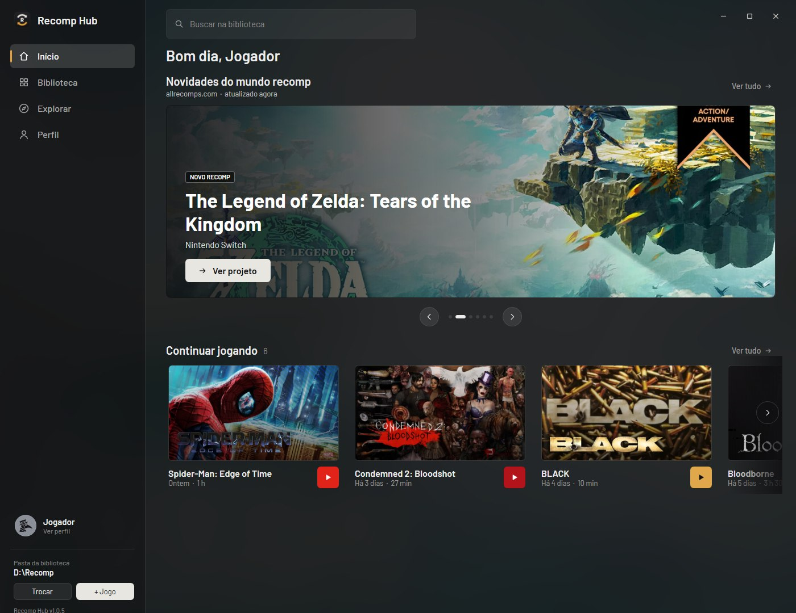
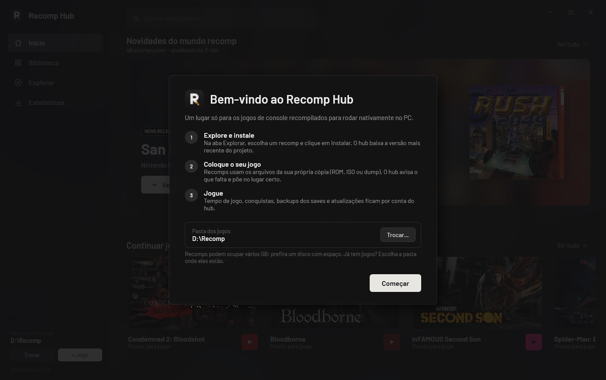
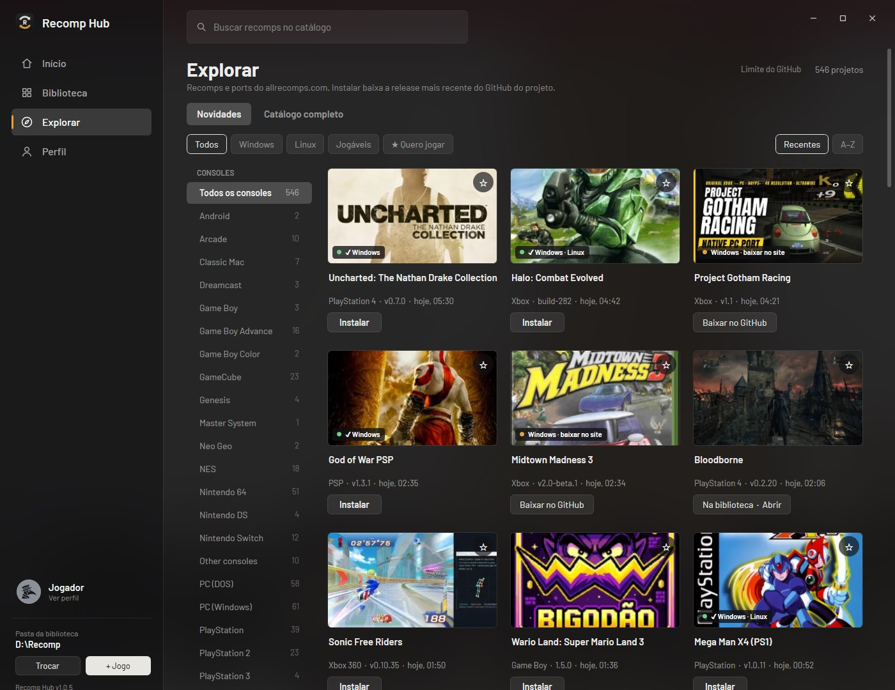
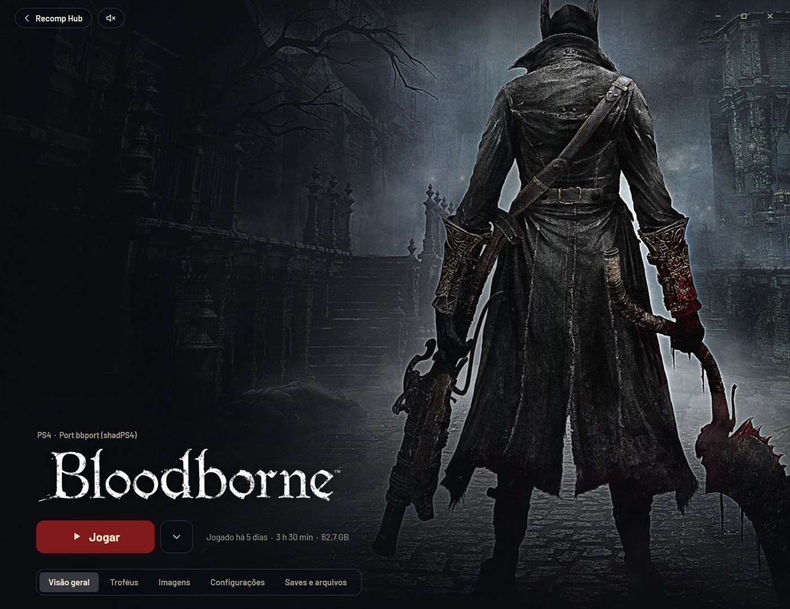
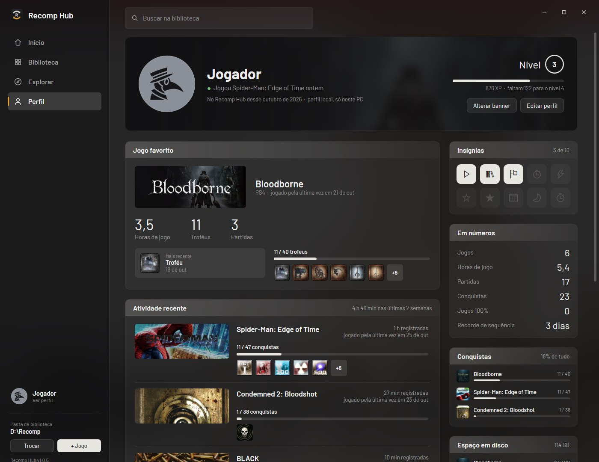

# Recomp Hub

Um lugar só para os jogos de console **recompilados para rodar nativamente no PC**:
Condemned 2, Bloodborne, inFAMOUS, Spider-Man, Perfect Dark e centenas de outros projetos da comunidade.
O hub encontra, instala, atualiza e abre os seus recomps, cada um com a própria página.



## Baixar

**[⬇ Baixar a versão mais recente](../../releases/latest)**: é um arquivo só, o `RecompHub.exe` (cerca de 2 MB). Site: **[erkdev01.github.io/RecompHub](https://erkdev01.github.io/RecompHub/)**

- Windows 10 ou 11 (64 bits). Não precisa instalar nada: é só abrir.
- Coloque o `RecompHub.exe` numa pasta sua (por exemplo `Documentos` ou a área de trabalho) e abra.
- O hub avisa quando sai uma versão nova e se atualiza com um clique.

### "O Windows protegeu o computador"

Na primeira vez, o Windows pode mostrar esse aviso azul. Ele aparece porque o programa não tem assinatura
digital paga, e não porque foi encontrado algum problema. Para abrir:

1. Clique em **Mais informações**.
2. Clique em **Executar assim mesmo**.

Alguns antivírus também desconfiam de programas sem assinatura que baixam arquivos. Se o seu reclamar,
você pode conferir o arquivo no [VirusTotal](https://www.virustotal.com) antes de abrir.

## Primeiros passos



1. **Escolha a pasta dos jogos.** Na primeira abertura, o hub sugere uma pasta no disco com mais espaço.
   Se você já tem recomps, escolha a pasta onde eles estão.
2. **Explore e instale.** Na aba **Explorar** estão os projetos do [allrecomps.com](https://allrecomps.com).
   Clique em **Instalar** e o hub baixa a versão mais recente do GitHub do projeto.
3. **Coloque o seu jogo.** Os recomps não trazem o jogo: eles usam os arquivos da **sua própria cópia**
   (ROM, ISO ou dump). Quando falta algum arquivo, a página do jogo avisa e coloca o arquivo no lugar certo.
4. **Jogue.** Tempo de jogo, conquistas, backup dos saves e atualizações ficam por conta do hub.

## O que ele faz

| | |
|---|---|
|  | **Explorar**: o catálogo do allrecomps com busca e filtro por console, mais os projetos da lista [Awesome Game Decompilations](https://github.com/CharlotteCross1998/awesome-game-decompilations) que têm versão para Windows. Antes de instalar, o hub mostra os dados do projeto no GitHub (estrelas, idade, última atualização) e avisa sobre projetos muito novos. |
|  | **Página de cada jogo**: arte oficial com parallax, conquistas e troféus, configurações do recomp, backups dos saves e a trilha sonora (coloque as músicas na pasta `OST` do jogo). |
|  | **Perfil**: jogo favorito, atividade recente, conquistas por jogo, insígnias e um nível que sobe com as horas jogadas, com o banner que você escolher. |

Também tem:

- **Atualizações dos jogos**: aviso quando sai versão nova; o hub baixa e instala sem mexer nos seus saves e configurações.
- **Discord**: o seu perfil mostra o jogo e há quanto tempo você está jogando (dá para desligar).
- **Controle**: navegue pelo hub inteiro com um controle de Xbox (direcional, A, B, LB/RB, Start).
- **Adicionar jogo**: qualquer `.exe` entra na biblioteca, com capa, tempo de jogo e backups.

## Perguntas frequentes

**Os jogos vêm junto?**
Não. O hub não distribui jogo nenhum: cada recomp usa os arquivos da sua cópia original.

**Preciso de conta ou de servidor?**
Não. O hub roda só no seu PC. Ele só consulta páginas públicas: o allrecomps, o GitHub (versões e downloads)
e os sites de imagens (PlayStation Store, Xbox, Wikipedia, LaunchBox). Ele não abre portas nem envia os seus dados para lugar nenhum.

**É seguro instalar recomps pelo hub?**
O hub só baixa pacotes do próprio GitHub, por HTTPS, e confere cada arquivo com o hash publicado.
Mesmo assim, instalar um recomp é rodar um programa feito por outra pessoa: dê preferência a projetos conhecidos.
O hub mostra as estrelas e a idade do projeto antes de instalar.

**Onde ficam os meus dados?**
Preferências, tempo de jogo e backups dos saves ficam em `%APPDATA%\RecompHub`; imagens e cache, em `%LOCALAPPDATA%\RecompHub`.

**Como desinstalar o hub?**
Apague o `RecompHub.exe` e as duas pastas acima. Os seus jogos continuam na pasta de jogos.
Para remover um recomp instalado pelo hub, use **Mais opções → Desinstalar…** na página dele.

## Para desenvolvedores

```powershell
powershell -ExecutionPolicy Bypass -File build.ps1              # gera RecompHub.exe
powershell -ExecutionPolicy Bypass -File build.ps1 -Out X.exe   # gera em outro lugar (útil com o hub aberto)
powershell -ExecutionPolicy Bypass -File tools\release.ps1 -Version 3.1.0   # versão para publicar (PUBLICAR.md)
```

- Usa o `csc.exe` do .NET Framework 4.x que já vem no Windows. O tema e as fontes vão embutidos no `.exe`.
- O ícone é gerado por `tools\make_icon.ps1`.
- `RECOMPHUB_PROFILE=<pasta>` usa outra pasta de configurações e mostra as boas-vindas como num PC novo,
  para testar sem mexer nas suas.

## Licença

O Recomp Hub é software livre sob a [GPL-3.0](LICENSE): você pode usar, estudar, modificar e redistribuir,
desde que as versões modificadas também saiam com o código aberto sob a mesma licença.
A licença vale para o código do hub. Os jogos e os recomps são de seus respectivos autores.

## Créditos

- Catálogo e novidades: [allrecomps.com](https://allrecomps.com). Cada recomp é obra dos autores do projeto no GitHub.
- Projetos extras do catálogo completo: [Awesome Game Decompilations](https://github.com/CharlotteCross1998/awesome-game-decompilations), de CharlotteCross1998.
- Extração de PKG de PS4: porte para C# do código do [shadPS4](https://github.com/shadps4-emu/shadPS4) (GPL-2.0 ou posterior). As chaves usadas são as públicas de PKG "fake" do próprio shadPS4.
- Ícones de avatar: [game-icons.net](https://game-icons.net), de Delapouite, Lorc e DarkZaitzev, sob a licença [CC BY 3.0](https://creativecommons.org/licenses/by/3.0/).
- Fontes (Google Fonts): Barlow, Barlow Semi Condensed, Bebas Neue, IM FELL English, Saira Stencil One e Bangers (SIL OFL),
  e Special Elite (Apache 2.0). As licenças estão na pasta `fonts`.
